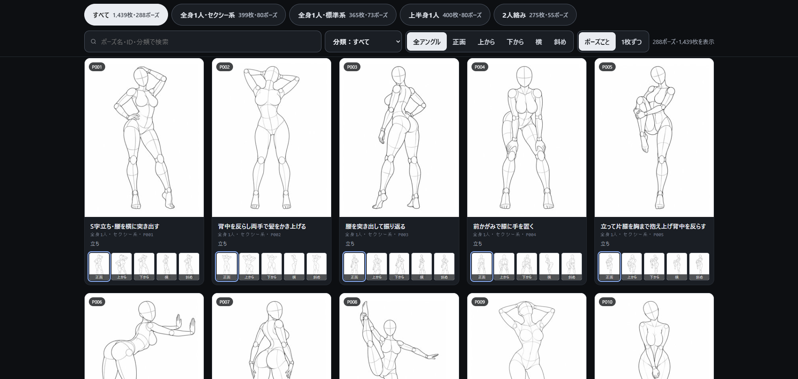
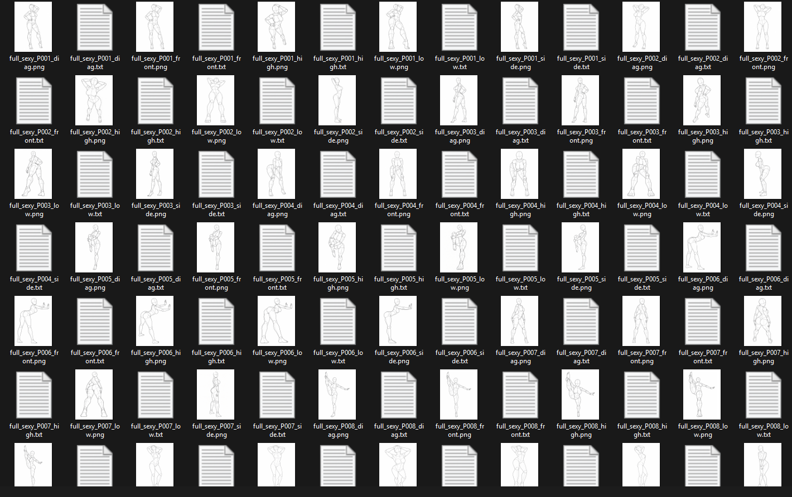

# 自然语言姿势与服装提示词

[English](README.md) | **简体中文**

## Credit / 原作者与参考来源

- 参考图库作者：[ギア / @giaaibusi](https://x.com/giaaibusi)
- 服装参考：[AI Costume Gallery / COSTUME-DB-01](https://ai-costume-gallery.pages.dev/)
- 姿势参考：[AI Pose Gallery / POSE-DB-01](https://ai-pose-gallery.pages.dev/)

感谢原作者提供服装与姿势参考图库。本项目与原作者及任何图像生成模型或平台无隶属关系，未获其背书。来源署名不代表已取得原作者对本项目的授权。

## 项目说明

英文自然语言姿势与服装描述，适用于支持自然语言提示词的图像生成模型和工具，不限于特定模型。可独立使用、组合提示词，也可搭配人物 LoRA。仓库收录 TXT 标注、文档，以及用于文档预览的图库页面截图 `assets/Preview.png` 和本地文件夹截图 `assets/preview2.png`，不包含可下载的原图数据集或图片索引。

这些是根据参考图观察编写的英文描述，不是原作者的原始生成提示词，也不是任何模型或平台官方导出的提示词。材质按可见外观描述。

## 预览



用户提供的图库页面截图，仅用于文档预览；来源：[AI Pose Gallery](https://ai-pose-gallery.pages.dev/)。

## 内容与 NSFW 提醒

- `姿势图库_Pose_Captions_1439/`：1,714 个 TXT，含原目录中的变体标注；1439 为参考图集名称。
- `服装图库_Costume_Captions_1407/`：1,407 个 TXT，按服装类别保存，保留原编号。

**双人姿势提示词包含 NSFW（成人向）内容。请自行筛选并合理使用，遵守适用法律及所用平台的规定。**

### 中英双语文件夹名称

素材主目录和分类子目录均采用中英双语命名。姿势分为全身单人性感、全身单人标准、上半身单人和双人姿势；服装分为春装、夏装、秋装、冬装、内衣、派对礼服、泳装和性感服装。打标词文件名与编号保持不变。

## 使用方法

按编号选择 TXT，直接作为提示词使用，或与人物描述组合，再按需补充场景、光线与构图。使用人物 LoRA 时，可按所用模型的要求加入触发词。

文本采用通用英文自然语言，不依赖专用标签或特定模型语法。可作为任何支持自然语言图像生成的工具的提示词素材；不同模型对描述的理解与还原程度可能不同，可按需调整措辞和长度。

姿势描述按 Body Position → Legs → Arms → Torso → Head → Camera Angle → Framing 的顺序组织。服装描述涵盖可见颜色、剪裁、材质和配饰，不绑定特定人物身份。

### Caption 文件放在哪里

打开 `姿势图库_Pose_Captions_1439/` 或 `服装图库_Costume_Captions_1407/` 下的分类子文件夹，即可找到 TXT 打标词。将按许可取得的参考图片放在对应 TXT 旁边，文件名主体保持一致：

```text
分类文件夹/
├── full_sexy_P001_front.png   # 本地参考图片
└── full_sexy_P001_front.txt   # 对应打标词
```



截图用于展示本地文件夹的排列方式。本仓库的打标词文件夹不包含参考图片。

### ChatGPT：人物图 + 服装图 + 姿势图

在支持图片生成的 ChatGPT 对话中，上传三张参考图片，并说明每张图的用途：

1. **人物图**：提供人物身份与外观参考。
2. **服装图**：提供服装、配色与配饰参考。
3. **姿势图**：提供身体动作、镜头角度与构图参考。

也可以粘贴对应的服装和姿势 caption，补充细节。例如：

```text
请根据以下参考生成一张新图片：
图 1 是人物参考，请保留人物可辨识的外观特征。
图 2 是服装参考，请采用其中的服装、颜色和配饰。
图 3 是姿势参考，请参考其中的身体动作、镜头角度和构图。
服装细节：[粘贴服装 caption]
姿势细节：[粘贴姿势 caption]
环境与光影：[填写场景和光线描述]
```

检查生成结果后，可以继续要求局部调整；参考图的还原程度无法保证。多图参考用法可参阅 [OpenAI 图片生成说明](https://learn.chatgpt.com/docs/image-generation)。

### ComfyUI：LoRA 角色提示词 + Caption + 环境光影

先在工作流中通过 LoRA 加载节点，加载与底模兼容的人物 LoRA。然后在正向提示词 / 文本编码节点中组合：

```text
[LoRA 触发词与角色描述]
+ [服装 caption]
+ [姿势 caption]
+ [环境与光影]
```

这里的 `+` 表示组合各部分，不是必须输入的语法。将占位内容替换为实际文本，拼接成连贯提示词；服装和姿势 caption 可按需选用一种或两种。例如：

```text
my_character, an adult woman with short black hair.
An ivory knit top with a pink pleated miniskirt and white sneakers.
Standing with one hand on the hip, head slightly tilted, three-quarter view, full-body framing.
On a quiet garden path, soft late-afternoon sunlight, gentle shadows.
```

将 `my_character` 替换为实际 LoRA 触发词。仅填写触发词不会加载 LoRA，仍需在工作流中选择、连接对应模型，并按需调整权重。根据所用模型调整 caption 的长度和措辞。

## 参考图片与下载规则

**原站禁止再分发、转载或转售图片，包括原尺寸图片和加工后的图片。本仓库不提供可下载的原图数据集，文档预览为图库页面与本地文件夹截图；文字标注的发布不代表图片的再分发许可。**

截至 2026-10-30，两个来源网站还明确禁止批量下载（包括工具自动获取），允许按站点规定逐张用于生成参考。免费使用不等于允许批量下载或再分发，请以原站最新说明为准。

按站点许可逐张获取的图片，可在本地放入对应打标词文件夹，并保持与 TXT 相同的文件名（仅扩展名不同），例如 `SPR-0001.png` 与 `SPR-0001.txt`。图片仅供本地参考，请勿提交到本仓库；`.gitignore` 已限制跟踪的文件类型。

### 使用 Agent 协助整理

如果你使用的 Codex、Muse、Grok 等 Agent 支持本地文件操作，可以让它协助整理你已按许可取得的图片。例如：

> 将我已按来源网站许可取得的姿势和服装图片，按编号放入对应的 TXT 打标词文件夹，保持图片与 TXT 同名，不上传或再分发图片。

**只有在取得作者明确的批量下载授权后，才使用以下指令；它不适用于原站当前的默认许可：**

```text
download all pose costume images from https://ai-costume-gallery.pages.dev/ and https://ai-pose-gallery.pages.dev/
```

使用前仍需确认所选 Agent 的联网、下载及本地文件能力，以及可能产生的服务费用。

## 进一步：让 Agent 制作个人本地 HTML 图库

按来源网站许可取得图片，并与 caption 配对后，可以让具备本地文件和编程能力的 Agent 制作一个简单 HTML 网页，方便个人浏览。这是可选的本地使用方式，本仓库没有附带图库程序。

将下面的路径占位内容替换为你的本地素材根目录，再把整段指令交给 Agent：

```text
请为我的姿势和服装参考素材制作一个简单的本地 HTML 图库，方便个人浏览。

素材目录：[填写本地姿势与服装文件夹的绝对路径]

只使用我电脑中已经存在的图片与 TXT 打标词。不要下载新素材，不要修改原文件，不要上传文件或发布网页。

扫描分类子文件夹，按相对文件夹和同名文件主体配对图片与 TXT。支持 PNG、JPG/JPEG、WebP，正确处理中文、日文文件名和含空格的路径。只有 TXT 没有图片时显示纯文字卡片；只有图片没有 TXT 时明确提示缺少 caption。变体 caption 保持独立条目，不要猜测匹配图片。

页面使用自适应缩略图网格，采用懒加载或分页。支持按姿势/服装和分类筛选，以及按文件名、ID、caption 文字搜索。点击卡片后查看大图和完整 caption，提供复制 caption 按钮及上一张/下一张切换。根据已有目录或文件名标签标记 NSFW 条目，默认隐藏，允许用户手动开启。

使用普通 HTML、CSS、JavaScript，不依赖外部 CDN、统计服务、API Key 或云服务。caption 按纯文本读取，显示文件名和 caption 时进行安全转义。图片使用相对路径，保留原文件位置。

优先生成内嵌 caption 数据的本地索引，让 index.html 可直接打开。如果浏览器限制导致必须使用本地服务器，提供仅绑定 127.0.0.1 的最简启动方式，并写清启动和停止步骤。确保复制按钮在所选模式下可用，并提供手动复制的备用方式。

生成文件放在单独的 local-gallery 文件夹。检查若干图片与 caption 配对是否正确，验证筛选、搜索、切换和复制功能。报告图片数、caption 数、已配对数及未配对数，最后告诉我如何打开网页。所有图片和图库数据只保留在本地，不加入 Git，也不公开发布。
```
